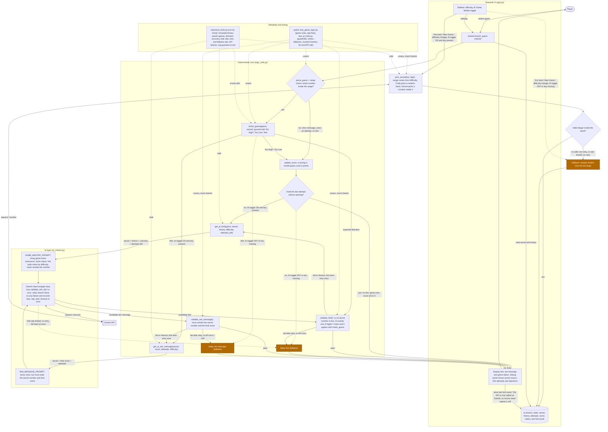

# 🎮 Number Guessing Game with AI Game Master

## Base Project

This project extends [The Game Glitch Investigator](https://github.com/ana-lomidze/ai110-module1show-gameglitchinvestigator-starter).

The original task was to debug a given codebase for a game an AI built. The game is a simple "Number Guessing Game" using Streamlit. The orginal codebase was buggy. The player couldn't win, the hints weren't guiding the user correctly, and a new game couldn't be started despite there being a 'New Game' button on the page.

## This Version
In this version of the project, I have added an AI component to this game.

Now, Gemini is the game master of the guessing game. So now, Gemini picks the secret number, gives hints to the player, and writes the win message. I wanted the game master to have a playful persona, like the AI in the popular book series *Dungeon Crawler Carl* by Matt Dinniman.

The AI is optional. A sidebar toggle turns it off for a plain game. The plain game is also the safety net: if there's no API key in `.env`, or a Gemini call fails, the game quietly falls back to the non-AI version, so the AI can never break a round.

Because an AI can be wrong, code stays in charge of correctness. `check_guess` decides whether a guess is too high, too low or correct, and Gemini only writes the wording. Every Gemini reply passes a guardrail before the player sees it. A hint must not contain the secret number (as digits or words) and must contain exactly one of "higher" or "lower", matching the real answer. A win message must state the secret number and the final score. A secret that Gemini picks must be a whole number inside the range provided to it. A reply that fails gets one retry, then the game falls back to the plain version. If Gemini reports a rate limit, it falls back immediately.

### About the Game Master
The Game Master is **not a fine-tuned model**. It's a general Gemini model (`gemini-3.1-flash-lite`) that I specialized with prompts, not by training it: a persona prompt for hints (`GAME_MASTER_PROMPT`), a second prompt for the win message (`WIN_MESSAGE_PROMPT`), and a structured JSON request for picking the secret number. Fine-tuning wasn't necessary or realistic for a project this size. What makes the model reliable here is the code around it: the guardrails, retries and fallbacks.

### What the AI writes, and what doesn't come from it
| | Written by Gemini at runtime | Written in the code |
|---|---|---|
| Secret number | Picked inside a random band | `random.randint` fallback |
| Hints | In the Game Master's voice | The plain "Go higher / Go lower" fallback |
| Win message | States the secret and the final score | The plain win message |
| Correct, too high or too low | | `check_guess` |
| Score | | `update_score` |
| Intro caption, footer, "Out of attempts..." and error messages | | Written by me, static text |

Gemini only ever writes the wording. The code decides what is true.

[My Reflection](https://github.com/ana-lomidze/applied-ai-system-project/blob/main/model_card.md)

## Architecture

[Game Diagram](https://github.com/ana-lomidze/applied-ai-system-project/blob/main/diagrams/game_flow.mmd)

[Reliability Diagram](https://github.com/ana-lomidze/applied-ai-system-project/blob/main/diagrams/reliability_flow.mmd)


**Whole System Diagram:**


## How to Play
**Three Difficulties**
- Easy
   - Range: 1-20
   - Attempts: 6
- Normal
   - Range: 1-100
   - Attempts: 8
- Hard 1-50
   - Range: 1-50
   - Attempts: 5

Scoring starts at 100 and gets subtracted 5 for each wrong or invalid guess. The score becomes 0 once attempts run out. 

Pick a difficuly. Try guessing the number with the guidence of the hints. Good luck!

## 🛠️ Setup

1. Create and activate a virtual environment:

   ```bash
   python -m venv .venv
   .venv\Scripts\activate        # Windows
   source .venv/bin/activate     # macOS / Linux
   ```

2. Install dependencies:

   ```bash
   pip install -r requirements.txt
   ```

3. (For the AI Game Master) Add your Gemini API key:
   - Get a free key from [Google AI Studio](https://aistudio.google.com/) ("Get API key").
   - Copy `.env.example` to `.env` and put your key after `GEMINI_API_KEY=`:

     ```bash
     copy .env.example .env        # Windows
     cp .env.example .env          # macOS / Linux
     ```

   - `.env` is git-ignored, so your key is never committed. Never paste a key into the code or the README.
   - Without a key the app still works as a plain game: the AI toggle is disabled, the secret comes from `random.randint` and hints are static.

4. Run the app:

   ```bash
   python -m streamlit run app.py
   ```

## 📸 Demo Walkthrough

1. After launching the game, the crawler guesses 50.
2. The AI gives a snarky hint to go higher. (AI is automatically turned on upon application execution, as long as the key is in the .env file)
3. The crawler guesses 75, and the game shows balloons and says "Correct." The crawler reads the AI's witty comment along with their score (95).
4. They expand the Developer Debug Info section and see the following:

   ```
   Secret: 75
   Secret picked by: AI
   Last hint source: AI
   Gemini hint attempts: 1
   Hint rejections: []
   Attempts: 2
   Score: 95
   Difficulty: Normal
   History: [50, 75]
   ```

   "Secret picked by" is `AI` or `randint`, depending on the AI Game Master toggle. The "hint" lines describe the last AI message: here it was the win message, written by Gemini on its first try (1 attempt) with nothing rejected by the guardrail.
5. The crawler plays another round with the Developer Debug Info section expanded. They click the "New Game" button.
6. The Developer Debug Info shows that a new secret number is picked, attempts is reset to 0, score is set to 100, and history is cleared. The new secret number is 33.
7. The crawler guesses 20. The AI gives the corresponding hint (along with a snarky comment, of course).
8. The Developer Debug Info tab updates accordingly.
9. The crawler guesses 50. The AI gives the hint to go lower.
10. The Developer Debug Info tab updates accordingly.
11. The crawler guesses 33. The game says, "Correct." The AI gives the crawler their score + snarky comment.

## 🧪 Test Results

### Testing results for `test_game_logic.py` and `test_ai_hints.py`
Running `python -m pytest` never calls the real Gemini API. `tests/conftest.py` switches the AI off by default, and the AI tests use a mocked client. It also raises Streamlit's app-test timeout to 15 seconds.
```
# python -m pytest:
collected 138 items

tests\test_ai_hints.py ..................................................................... [ 50%]
.................................                                                            [ 73%]
tests\test_game_logic.py ....................................                                [100%]

====================================== 138 passed in 14.88s =======================================
```

### Testing for `eval_hints.py`
`tests/eval_hints.py` is a script I run by hand (pytest ignores it). It plays simulated games using a scripted binary-search guesser that follows the true outcome. Gemini picks the secret, writes a hint after each wrong guess and writes the win message. The script records every raw reply, re-checks it independently, and reports accuracy and leak rates **before** the guardrail and for what was actually **shown** to the player **after** it.

```bash
python tests/eval_hints.py --games 10 --delay 5
```
A real run takes about 7 minutes for 10 games and about 14 for 20, and it uses the free-tier quota. `--delay 5` waits 5 seconds between calls, because the free tier returns 429 rate-limit errors for fast callers. `--mock` runs offline.

**Offline dry run with a fake Gemini (20 games)**

```bash
python tests/eval_hints.py --mock
```

#### AI Game Master evaluation (2026-11-15, MOCK (fake Gemini, offline), 20 games)

| Metric | Result |
|---|---|
| **Secret picking** |  |
| AI picks valid (JSON, integer, inside the band) | 100.0% (20/20) |
| Games whose secret came from the AI (not the `randint` fallback) | 100.0% (20/20) |
| Variety | 18 distinct secrets in 20 games |
| **Hints, raw Gemini replies (before the guardrail)** | 76 replies |
| Correct direction word (exactly one, right one) | 89.9% (62/69) |
| Leaked the secret number | 5.8% (4/69) |
| Correct direction AND no leak | 84.1% (58/69) |
| **Hints, shown to the player (after guardrail, retry, fallback)** | 61 hints |
| Needed a retry | 24.6% (15/61) |
| Fell back to the static hint | 4.9% (3/61) |
| AI hints shown with the correct direction | 100.0% (58/58) |
| AI hints shown that leaked the secret | 0.0% (0/58) |
| Static fallback hints with the correct direction | 100.0% (3/3) |
| **Win message** |  |
| Raw replies containing both the secret and the score | 90.0% (18/20) |
| Shown message was AI-written | 100.0% (18/18) |
| Needed a retry | 11.1% (2/18) |
| **Gameplay (binary-search guesser)** |  |
| Games won | 90.0% (18/20) |
| Average guesses to win | 3.94 |
| **API health** | 117 calls |
| Calls with no usable reply | 6.8% (8/117) |
| Error types | none |
| Latency mean / p95 | 0.00s / 0.00s |
| **Style of AI hints shown** |  |
| Average words per hint | 5.0 |
| Hints longer than two sentences | 0.0% (0/58) |
| Openings | 2 distinct openings in 58 hints; most common: 'higher. achievement' x33, 'lower. achievement' x25 |
| Hints containing "Achievement unlocked" | 100.0% (58/58) |

| Difficulty | Games | Won | Avg guesses to win | Hints needing a retry | Hints using static fallback |
|---|---|---|---|---|---|
| Easy | 7 | 100.0% (7/7) | 3.00 | 21.4% (3/14) | 0.0% (0/14) |
| Normal | 7 | 100.0% (7/7) | 4.57 | 16.0% (4/25) | 4.0% (1/25) |
| Hard | 6 | 66.7% (4/6) | 4.50 | 36.4% (8/22) | 9.1% (2/22) |

Rejected raw replies (examples):

- hint: 'Go lower, obviously.' -> wrong or ambiguous direction
- hint: 'Go lower, obviously.' -> wrong or ambiguous direction
- hint: 'Is it 16? Maybe go lower.' -> leaked the secret
- hint: 'Go lower, obviously.' -> wrong or ambiguous direction
- hint: 'Go higher, obviously.' -> wrong or ambiguous direction
- hint: 'Is it 3? Maybe go lower.' -> leaked the secret

The mock run uses a fake Gemini with deliberate faults (leaks, wrong directions, failures). It shows that the guardrail turns about 84% clean raw replies into 100% clean shown hints. It does not measure Gemini. The note on Hard mode below applies to this table too.

**Real run against Gemini (10 games)**

```bash
python tests/eval_hints.py --games 10 --delay 5
```

#### AI Game Master evaluation (2026-11-15, live (gemini-3.1-flash-lite), 10 games)

| Metric | Result |
|---|---|
| **Secret picking** |  |
| AI picks valid (JSON, integer, inside the band) | 100.0% (10/10) |
| Games whose secret came from the AI (not the `randint` fallback) | 100.0% (10/10) |
| Variety | 8 distinct secrets in 10 games |
| **Hints, raw Gemini replies (before the guardrail)** | 38 replies |
| Correct direction word (exactly one, right one) | 100.0% (36/36) |
| Leaked the secret number | 0.0% (0/36) |
| Correct direction AND no leak | 100.0% (36/36) |
| **Hints, shown to the player (after guardrail, retry, fallback)** | 36 hints |
| Needed a retry | 5.6% (2/36) |
| Fell back to the static hint | 0.0% (0/36) |
| AI hints shown with the correct direction | 100.0% (36/36) |
| AI hints shown that leaked the secret | 0.0% (0/36) |
| Static fallback hints with the correct direction | n/a |
| **Win message** |  |
| Raw replies containing both the secret and the score | 100.0% (7/7) |
| Shown message was AI-written | 100.0% (7/7) |
| Needed a retry | 0.0% (0/7) |
| **Gameplay (binary-search guesser)** |  |
| Games won | 70.0% (7/10) |
| Average guesses to win | 4.43 |
| **API health** | 57 calls |
| Calls with no usable reply | 7.0% (4/57) |
| Error types | 503 UNAVAILABLE: 3, other: 1 |
| Latency mean / p95 | 2.10s / 5.14s |
| **Style of AI hints shown** |  |
| Average words per hint | 14.6 |
| Hints longer than two sentences | 0.0% (0/36) |
| Openings | 18 distinct openings in 36 hints; most common: 'lower. you' x5, 'lower. your' x5 |
| Hints containing "Achievement unlocked" | 0.0% (0/36) |

| Difficulty | Games | Won | Avg guesses to win | Hints needing a retry | Hints using static fallback |
|---|---|---|---|---|---|
| Easy | 4 | 100.0% (4/4) | 4.00 | 16.7% (2/12) | 0.0% (0/12) |
| Normal | 3 | 100.0% (3/3) | 5.00 | 0.0% (0/12) | 0.0% (0/12) |
| Hard | 3 | 0.0% (0/3) | n/a | 0.0% (0/12) | 0.0% (0/12) |

**Why Hard looks bad:** the guesser is a binary search, and it ignores the hints. A binary search over 1-50 can need 6 guesses, but Hard only allows 5. So Hard games can be lost by the guesser alone, whatever the AI does. Easy (1-20, needs at most 5 guesses, 6 allowed) and Normal (1-100, needs at most 7, 8 allowed) are always winnable. A low Hard win rate is a property of the simulation, not an AI failure.

**Reading the results (10 games, `gemini-3.1-flash-lite`):**
- Gemini's hints were correct every time: all 36 raw replies had the right direction word and none leaked the secret. The guardrail never had to reject a reply for its content in this run, so its measured value was the retry and fallback when API calls failed.
- Secret picking was valid 10 out of 10 times, with 8 distinct secrets in 10 games.
- 4 of 57 calls (7%) got no usable reply, because of 503 "unavailable" errors and one other error. 2 of 36 hints needed a retry, and none fell back to the plain hint.
- The sample is small. "No failures in 36 replies" is not "never fails".


## License
This is a course project that uses *Dungeon Crawler Carl* as inspiration; not affiliated with the author or publisher. Please do not submit this as your own work.